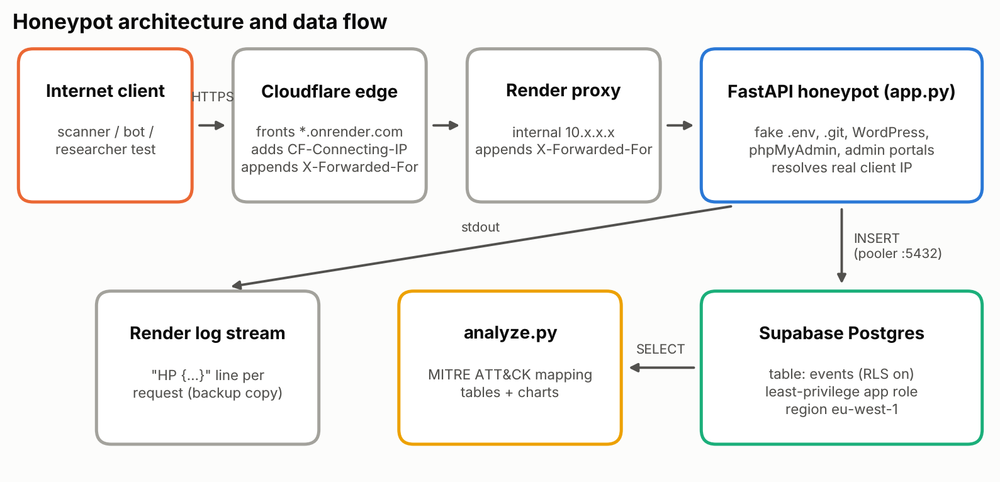
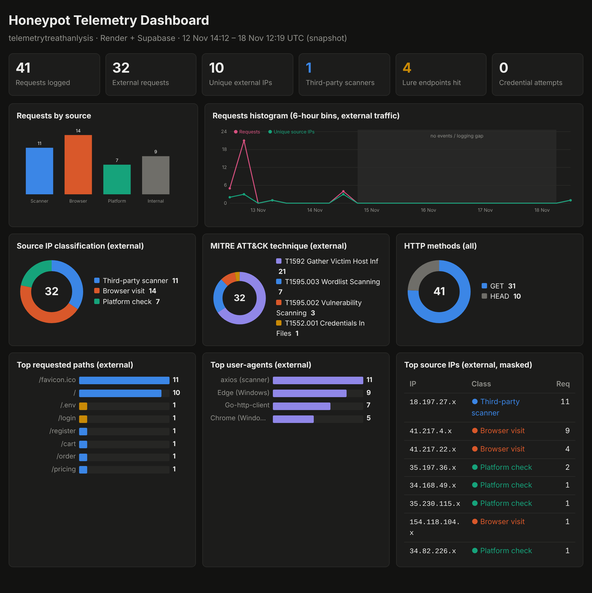
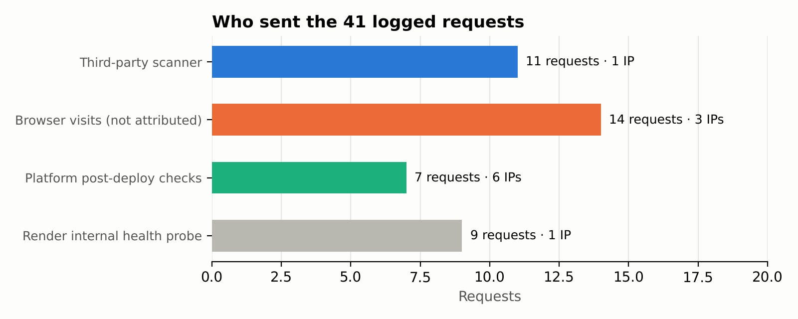
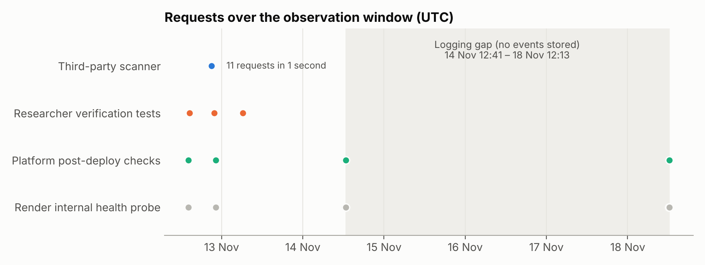
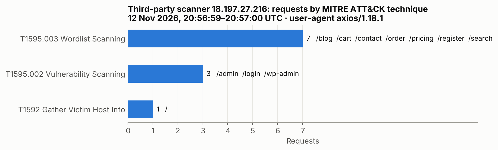

# Telemetry and Threat Analysis: A Low-Interaction Web Honeypot on Render

> **Draft.** Items marked **[TODO]** still need screenshots.

## 1. Introduction and objectives

The project deployed a low-interaction web honeypot to the public Internet to observe what automated clients do when they find a newly published web server. The objectives were to:

1. Build a service that looks like a carelessly configured web server: an exposed `.env` file, an exposed `.git` directory, WordPress and phpMyAdmin login pages, and admin portals.
2. Record every request with enough detail to tell real clients apart from forged headers, recovering the true client IP from behind the hosting provider's reverse-proxy chain.
3. Store the telemetry outside the hosting container (in Supabase Postgres), so redeploys and restarts do not lose data.
4. Classify the observed activity and map it to MITRE ATT&CK techniques.

## 2. Architecture

| Component | Technology | Notes |
|---|---|---|
| Honeypot | FastAPI 0.115 + uvicorn | `docs`, `redoc` and `openapi` routes disabled to hide FastAPI fingerprints; `--no-server-header`, with fake `Server: Apache/2.4.41 (Ubuntu)` and `X-Powered-By: PHP/7.4.3` headers |
| Hosting | Render web service (free plan) | Public URL `https://telemetrytreathanlysis-tj0r.onrender.com` (an earlier instance ran at `https://telemetrytreathanlysis.onrender.com`) |
| Storage | Supabase Postgres 17 | `events` table (see `schema.sql`); the app connects as a dedicated least-privilege role allowed only `SELECT`/`INSERT` on `events` |
| Keep-alive | UptimeRobot, 5-minute interval | Hits `/healthz`, which is deliberately **not** logged so it does not pollute the data |

## 3. Deception design

| Lure endpoint(s) | Imitates | Response returned |
|---|---|---|
| `*/.env*` | Laravel/Node environment file left in the web root | Fake `APP_KEY`, DB password and AWS key pair (all fabricated, non-functional) |
| `/.git/config`, `/.git/HEAD` | Exposed Git repository | Plausible `config` pointing at a fictitious `acme-corp/internal-portal` repo |
| `/wp-login.php`, `/wp-admin*` | WordPress login | Login form; any POST returns "Invalid username or password" and the submitted credentials are captured |
| `*phpmyadmin*`, `*pma*`, `*adminer*` | phpMyAdmin / Adminer | Login form; POST returns "Cannot log in to the MySQL server" |
| `/admin`, `/administrator`, `/login`, `/manager`, `/console`, `/cpanel`, `/boaform`, `/signin`, `/user/login` | Generic admin panels and router UIs | "Administration Portal" login form |
| `*actuator*` | Spring Boot Actuator `/env` | JSON listing active profile `prod` and a masked DB password |
| `*server-status*` | Apache `mod_status` | Fake uptime/access counters |
| `*.sql`, `*backup*`, `*.bak`, `*.zip`, `*.tar.gz` | Database dumps and backups | Truncated fake MySQL dump header |
| `/config.json`, `/config.php`, `/config.yml`, `/wp-config.php.bak` | Leaked application config | JSON with fake DB credentials |
| `/robots.txt` | robots.txt | Disallows `/admin/`, `/backup/`, `/.git/`, `/phpmyadmin/`, `/internal/` to invite follow-up crawling |
| anything else | Apache default | Apache-styled `404 Not Found` page |

Safety: nothing in the application executes, evaluates or forwards attacker input. Request bodies are truncated to 4 KB, and all secrets served are fabricated.

## 4. Reverse-proxy telemetry (real client IP)

Behind Render, the TCP peer the app sees is a proxy, not the client. `client_ip()` in `app.py` therefore trusts sources in this order:

1. `CF-Connecting-IP` / `True-Client-IP`, set by Cloudflare, which fronts every `*.onrender.com` host.
2. The first *public* (globally routable) address in `X-Forwarded-For`.
3. The socket peer, as a last resort.

The raw `X-Forwarded-For` value is always stored alongside, because a client can pre-fill that header to spoof an address.

**Verification.** The researcher visited the site from a known machine and the stored row was compared with it. The researcher reported their public IP as `154.120.118.179` (masked below). Example row (event `cc8fe876ba92`, 22 Nov 2026 20:39:39 UTC, `GET /`, Windows Chrome):

| Field | Value |
|---|---|
| `ip` (resolved) | `154.120.118.x` |
| `xff` (raw) | `154.120.118.x, 172.68.247.11, 10.27.115.103` |
| Headers present | `cf-connecting-ip`, `true-client-ip`, `cf-ipcountry`, `x-forwarded-for`, `rndr-id` |

The chain reads **client → Cloudflare edge (172.68.x.x) → Render internal (10.x.x.x)**, and the app correctly resolved the left-most public address, which equals the IP the researcher reported. The same machine's four requests (20:39:39 to 20:39:53 UTC) all resolved to that address. **[TODO: add a screenshot of the Supabase row and of https://ifconfig.me from that machine.]**

Events with `ip = 127.0.0.1` come from Render's own in-container health probes (`HEAD /` with `Go-http-client/1.1`). This matches the design: no forwarding headers, peer equals loopback.

## 5. Deployment

| Item | Value |
|---|---|
| Repository | `jaycash988/telemetrytreathanlysis` (GitHub) |
| Platform | Render web service, Python runtime, free plan, region Frankfurt |
| Public IP addresses | `216.24.57.16` and `216.24.57.18` (resolved with `nslookup` on 22 Nov 2026). The hostname is a CNAME to `gcp-us-west-1.origin.onrender.com`, which in turn points at Cloudflare's CDN: `telemetrytreathanlysis-tj0r.onrender.com` → `gcp-us-west-1.origin.onrender.com` → `gcp-us-west-1.origin.onrender.com.cdn.cloudflare.net` → `216.24.57.16`, `216.24.57.18`. A free Render web service has no dedicated IP, so these shared addresses can change. |
| Build / start | `pip install -r requirements.txt` / `uvicorn app:app --host 0.0.0.0 --port $PORT --no-server-header` |
| Health check | `/healthz` (unlogged) |
| Environment variables | `DATABASE_URL` (Supabase Session pooler URI), `EXPORT_TOKEN` (secret path for `/_export/<token>`), `MY_IPS` (own test IPs; left empty), `PYTHON_VERSION=3.11.9` |
| Database | Supabase project `telemetrytreathanalysis`, region eu-west-1, Postgres 17 |

**[TODO screenshots: Render build log, Render service page with URL, Supabase `events` table, Render logs showing `HP {...}` lines.]**

## 6. Observation window

| Period (UTC) | Instance | Status |
|---|---|---|
| 12 Nov 14:12 → 14 Nov 12:41 | `telemetrytreathanlysis.onrender.com` | Logging to Supabase (last stored event 14 Nov 12:41) |
| 14 Nov 12:41 → 18 Nov 12:13 | — | **No events stored.** The original instance stopped writing to the database, and its replacement (created 16 Nov) failed to start until its `DATABASE_URL` was configured |
| 18 Nov 12:13 → end of study | `telemetrytreathanlysis-tj0r.onrender.com` | Logging to Supabase |

Total span covered: about 142 hours. The effective logging time was shorter, because of the gap above.

## 7. Results

All figures exclude the 9 internal Render health probes from `127.0.0.1`.

| Metric | Value |
|---|---|
| Total requests logged | 32 |
| Unique source IPs | 10 |
| Credential submissions | 0 |
| Exploit payloads (SQLi, LFI, Log4Shell, command injection) | 0 |
| Requests with tool/scanner user-agent | 18 (axios, Go-http-client) |

**Source breakdown.** The traffic falls into three groups:

| Group | IPs | Requests | Evidence |
|---|---|---|---|
| Browser visits (not attributed) | 3 (`41.217.22.x`, `41.217.4.x`, `154.118.104.x`) | 14 | Desktop Chrome/Edge browsers; referers show manual visits to `/`, `/.env` and `/healthz`. The researcher confirmed these are **not** their own IPs, so they are unidentified human visitors (for example, other people who opened the link). Their identity is not established. |
| Hosting-platform checks (inferred) | 6 Google Cloud addresses (`34.x`, `35.x`) | 7 | `GET /` with `Go-http-client/2.0`, each arriving 1–9 seconds after a new instance started up; consistent with an automated post-deploy reachability check |
| **Third-party automated scanner** | 1 (`18.197.27.216`, AWS eu-central-1 range) | 11 | See below |

**The third-party scanner.** On 12 Nov at 20:56:59–20:57:00 UTC, about 6.7 hours after the first deploy, `18.197.27.216` sent 11 `GET` requests in about one second with user-agent `axios/1.18.1`:

`/`, `/login`, `/register`, `/cart`, `/order`, `/pricing`, `/contact`, `/blog`, `/search`, `/admin`, `/wp-admin`

The requests carried `sentry-trace` and `baggage` headers, which are distributed-tracing headers emitted by a Node.js service instrumented with Sentry. This indicates an automated SaaS crawler or site-fingerprinting service rather than a human. The path list mixes generic e-commerce pages with the two most common admin panels (`/admin`, `/wp-admin`), the signature of a lightweight technology/attack-surface profiler. It did not request any of the high-value lures (`.env`, `.git/config`, backups) and submitted no credentials.

**Figures:**

Charts produced by `analyze.py` across all external traffic (`results/charts/mitre.png`, `paths.png`, `timeline.png`) can go in the appendix.

Geolocation was not available when the charts were generated (ip-api.com unreachable from the analysis environment). Re-running `python analyze.py --exclude 127.0.0.1` on a normal Internet connection fills in the country column and `charts/countries.png`.

## 8. MITRE ATT&CK mapping

| Observed behaviour | Technique | Events | Source |
|---|---|---|---|
| Enumeration of common site paths (`/login`, `/register`, `/cart`, `/blog`, …) | T1595.003 Active Scanning: Wordlist Scanning | 7 | Scanner |
| Probing admin portals (`/admin`, `/wp-admin`) | T1595.002 Active Scanning: Vulnerability Scanning | 2 | Scanner |
| Fetching `/`, `/favicon.ico` to fingerprint the host | T1592 Gather Victim Host Information | 21 | Mixed (mostly browser visits and platform checks) |
| Request for `/.env` | T1552.001 Unsecured Credentials: Credentials In Files | 1 | Browser visit (not attributed) |

Lures that were never triggered by third parties: credential brute force (T1110), web-shell probing (T1505.003), IoT/router exploitation (T1190), backup hunting.

## 9. Discussion

The main finding is how **little** unsolicited traffic a honeypot on a Platform-as-a-Service subdomain receives. Studies of honeypots on bare cloud IPs typically record thousands of requests per day. This one received one genuine third-party scanner in about six days. Three properties of the hosting set-up explain the difference:

1. **No Certificate Transparency trail.** Most hostname-aware scanners discover new sites by watching CT logs for newly issued certificates. Render serves `*.onrender.com` with a wildcard certificate, so creating this service never published its hostname to CT logs.
2. **No dedicated IP.** Mass scanners such as Mirai variants, masscan and zgrab sweeps target IP addresses. Here the IP belongs to Cloudflare's shared edge, and a request without the correct `Host` header never reaches the service. IP-sweeping botnets, which generate most honeypot traffic, are therefore invisible.
3. **Free-tier constraints.** Render's free plan sleeps after 15 minutes idle, and the study lost about four days of logging during a service migration.

The one scanner that did arrive behaved like a commercial attack-surface or technology-profiling service. It was quick, broad and shallow, did not follow `robots.txt` hints, and had no interest in credentials. This is consistent with the reconnaissance stage of ATT&CK (TA0043) rather than initial access.

The reverse-proxy work (section 4) is a positive result: the three-hop chain was correctly unwound, and the design stores the raw header so spoofing can be detected after the fact.

## 10. Limitations and ethics

**Limitations**

- Small sample (one third-party source); results describe this deployment and cannot be generalised to Internet-wide threat levels.
- Logging gap from 14 to 18 Nov.
- The country of origin was not resolved in this draft.
- The classification of the Google Cloud requests as platform checks is inferred from timing, not confirmed by Render.

**Ethics**

- Passive, low-interaction design: no attacker input is executed, and nothing is attacked back.
- All "leaked" secrets are fabricated and grant no access to anything.
- Collected IP addresses are personal data under GDPR. They are stored in a private database with row-level security, the researcher's own IPs are masked in this report, and the data will be deleted after assessment.
- Hosted within Render's acceptable-use policy; it serves only static decoy content.

## 11. Appendix

- Source code: `app.py`, `analyze.py`, `schema.sql`, `render.yaml` in this repository.
- **[TODO screenshots: code in editor, local curl test, GitHub repo, Render build log, Render service page, Supabase table, Render live logs, analyze.py output, charts.]**
